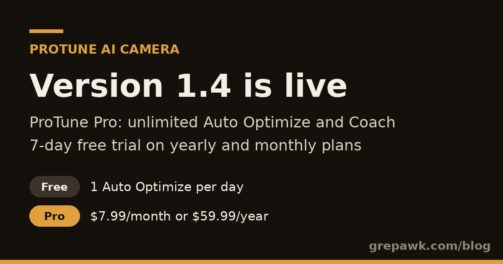

ProTune AI Camera 1.4 is now on the [App Store](https://apps.apple.com/us/app/protune-ai-camera/id6813991381). ProTune is an iPhone camera that reads the scene and sets real capture dials for you: shutter, ISO, EV, white balance, focus and zoom. This release adds a paid plan and makes buying it more reliable.

## ProTune Pro is here

Pro gives you unlimited Auto Optimize and Coach. The free tier keeps working with a daily limit.

| | Free | Pro |
| --- | --- | --- |
| Browse every recipe | Yes | Yes |
| Live viewfinder | Yes | Yes |
| Auto Optimize | 1 per day | Unlimited |
| Manual dials, full Teach Mode, field checklists | No | Yes |

Pro costs $7.99 a month or $59.99 a year. Both plans start with a 7-day free trial for new subscribers. Subscriptions go through Apple In-App Purchase, and you can cancel in your Apple account settings.

## A paywall that loads

Sometimes the App Store is slow and sends back no plans. Before 1.4, the paywall could get stuck with disabled placeholder buttons. Now the app retries loading the plans with a short backoff. If they still do not arrive, it shows a clear message and a one-tap Retry button.

## Stability fixes

1.4 fixes a crash that some testers hit. The camera sometimes reported an invalid reading, and turning it into a whole number crashed the app. The app now checks those readings first.

## What comes next

The selfie looks that Auto Optimize picks on the front camera are covered in [How ProTune picks a selfie look on the front camera](https://grepawk.com/blog/protune-selfie-auto-optimize). That work is not part of 1.4.

## Try it

Get [ProTune AI Camera on the App Store](https://apps.apple.com/us/app/protune-ai-camera/id6813991381) and tap Auto Optimize.
