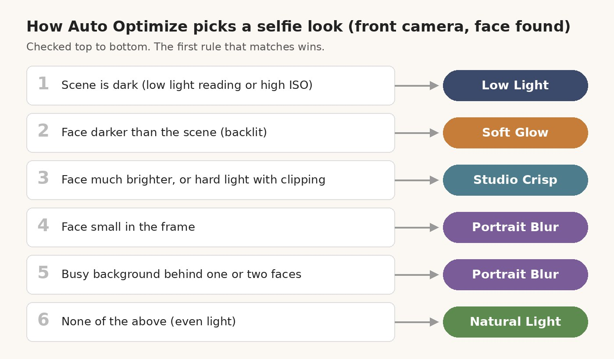

ProTune is an AI camera app for iPhone. Its Auto Optimize button reads the scene and sets the camera for you. This week it learned selfies: on the front camera, with a face in the frame, it now picks one of five selfie looks and adjusts its own settings to match. This post explains how it chooses and what each look does to the photo.

## Five selfie looks

| Look | What it is for |
| --- | --- |
| Natural Light | Even light, a light touch |
| Soft Glow | Backlit faces, with a soft highlight bloom on skin |
| Studio Crisp | Hard light, with white balance held steady once exposure settles |
| Low Light | Dim rooms, with noise reduction |
| Portrait Blur | A small face or a busy background, with the background blurred |

Each look sets the light at capture time, then runs a face-aware pass on the still photo. That pass uses only Apple's Vision and Core Image frameworks. There are no third-party SDKs or model downloads. It does no reshaping, no slimming, no eye enlarging and no skin lightening.

## How Auto Optimize chooses

The rules are checked in order, and the first match wins:

1. The scene is dark, or the camera is metering at a high ISO: Low Light.
2. The face is darker than the scene around it: Soft Glow.
3. The face is much brighter than the scene, or the light is hard and clipping: Studio Crisp.
4. The face is small in the frame: Portrait Blur.
5. One or two faces in front of a busy background: Portrait Blur.
6. Otherwise: Natural Light.

The gate comes first. This only happens on the front camera and only when a real face is found. On the back camera, or with no face, Auto Optimize behaves as before.

Your choice still wins. A look you ask for by voice or by name comes first, then a look you picked yourself this session, then the selfie choice, then the regular look suggestions.

When a selfie look applies, you see a short warm glow around the edge, a bracket around the face, a soft haptic, and a pill such as "Selfie · Soft Glow · low light" for two seconds. With Reduce Motion on, these become simple fades.

## What happens to the photo

On the still image, the selfie pass:

- finds the face landmarks and the person outline
- builds a skin mask that leaves out the eyes, brows and lips
- smooths skin while keeping most of the fine texture
- softens the area under the eyes, but never brighter than your own cheek
- sharpens only eyes, brows, lips and hair
- blurs the background outside the person, for Portrait Blur

The strength of each step has a hard cap. The under-eye step follows a tilted head, and it skips itself when glasses, hair or a hand cover the area. Smaller faces in the background are left alone. The processing runs off the main thread, so the shutter does not freeze the screen.

## Keeping dim selfies bright

An early build of this feature could turn a dim selfie nearly black. The front camera in a dark room wants a slow shutter, and the solver's speed cap for selfies pushed the exposure several stops too dark, then locked it.

The fix keeps the front camera on automatic exposure in low light, with only a positive brightness bias. A safety check also compares the frame after Auto Optimize with the one before. If it came out more than a stop darker than intended, the camera goes back to plain auto exposure and says so. The status text now reports what actually changed instead of what it tried to do.

## Try it

ProTune is on the [App Store](https://apps.apple.com/us/app/protune-ai-camera/id6813991381). Flip to the front camera and tap Auto Optimize.
